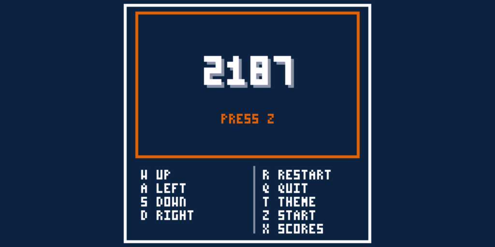
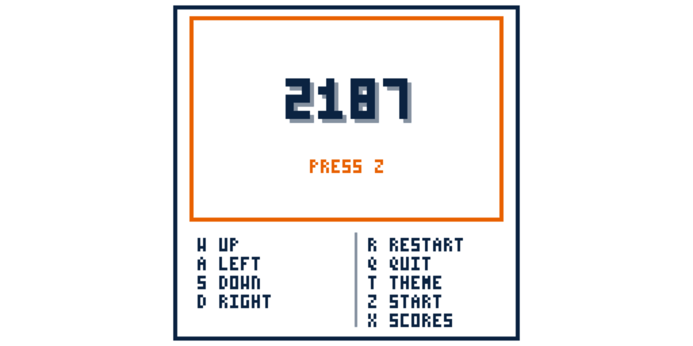

# mips-2187

This is 2048 in base 3, written in MIPS assembly for MARS. Two tiles that match merge into one tile worth three times as much, so 3 and 3 make 9 and 9 and 9 make 27, and you win when you make a 177147 tile.

COMP 3350, Fall 2026. Made by August Basinger, Levi Webb, Phillip Gill, Jacob Womack and Caleb Stewart.

Gameplay video: https://youtu.be/lpDhE0pCk6c

## What you need

- Java 8 or newer.
- MARS 4.5. We used the course's `Mars_4_5_updated.jar`.
- This repo with the `assembly` and `graphics` folders next to each other. The game loads the graphics files from `../graphics/`, so it won't build if you move one of them.

## How to run it

1. Open MARS.
2. In Settings, turn off "Assemble all files in directory". If it's on you'll get duplicate label errors.
3. Open `assembly/2178_game.asm`.
4. Open Tools > Bitmap Display and set:
   - Unit Width in Pixels: 1
   - Unit Height in Pixels: 1
   - Display Width in Pixels: 512
   - Display Height in Pixels: 256
   - Base address for display: 0x10010000 (static data)

   Then click "Connect to MIPS".
5. Open Tools > Keyboard and Display MMIO Simulator and click "Connect to MIPS".
6. Press F3 to assemble and F5 to run. Turning the run speed slider all the way up makes it draw faster.
7. Click in the bottom box of the keyboard tool and type your keys there. The game only reads keys from that box.

Leave both tools open while you play.

## Controls

| Screen | Key | What it does |
| --- | --- | --- |
| Start screen | Z | Start a game |
| | X | Show the top 5 scores (X again closes it) |
| | T | Switch between the navy and white theme |
| | Q | Quit |
| In a game | W, A, S, D | Move the tiles up, left, down or right |
| | Q | End the game and go back to the start screen |
| Win or lose screen | R | Play again |
| | Q | Go back to the start screen |

After every move that changes the board, a new 3 shows up in an empty spot (sometimes a 9 instead). Merging adds the new tile's value to your score. You lose when nothing can move. High scores only last until you close the program.

## How it works

The board is 16 words in memory, one per tile, row by row. Each tile holds an exponent instead of its real number, so 0 is empty, 1 is a 3, 2 is a 9 and 11 is 177147, and merging two tiles just adds 1 to the exponent. A table called `pow3` turns an exponent back into the real number when we need it for the score or the screen.

Each turn the game waits for a key, slides and merges every row or column, checks for a win or loss, adds a new tile and redraws the board. The graphics only read the board, score, theme and high scores and never change them, which let us write the logic and the drawing separately and join them at the end.

Everything on screen is made of filled rectangles drawn into the Bitmap Display memory. The numbers and letters use a tiny 3 by 5 pixel font where each character is one word of bits, and we draw each lit bit as a square so the same font works at any size.

We wrote the whole game in Python first to figure out the rules and how to split up the work, then turned each Python file into a part of the assembly file. The Python version is still in the `python` folder.

## Folders

| Path | What's in it |
| --- | --- |
| `assembly/2178_game.asm` | The game. This is the file you open in MARS. |
| `graphics/` | All of the drawing code. `graphics.asm` is a small test that draws the screen with fake data and isn't part of the game. |
| `python/` | The Python version. Run `python main.py` inside that folder. |
| `gifs/` | Gameplay GIFs from MARS. |

## Who did what

| Person | Part |
| --- | --- |
| August Basinger | Graphics: everything in `graphics/` |
| Levi Webb | Game loop, keyboard input, score, start screen and high scores |
| Jacob Womack | Movement: turning each direction into rows and columns |
| Phillip Gill | Sliding and merging tiles |
| Caleb Stewart | Board setup, new tiles, and checking for a win or loss |
